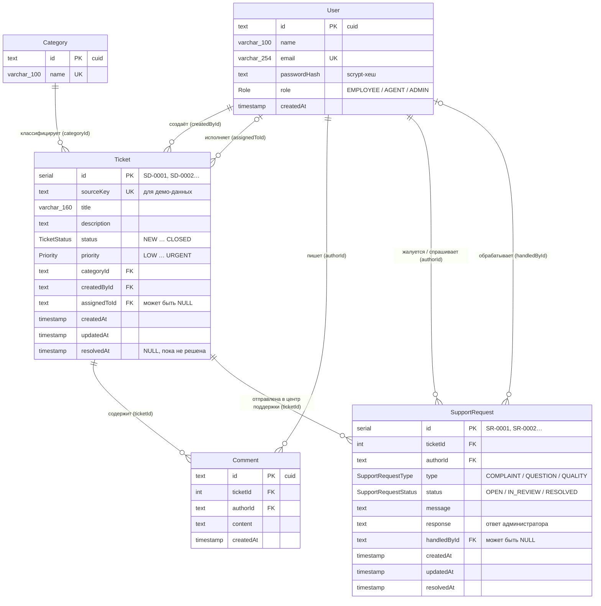

# ServiceDesk: база данных

Документ для защиты: как устроена база, почему именно так и как это доказать вживую. SQL-запросы для показа лежат в [database-demo.sql](database-demo.sql), каждый проверен на рабочей базе проекта.

## Коротко, за 30 секунд

«Данные ServiceDesk хранятся в PostgreSQL 17 в облаке Neon. В базе пять основных таблиц: пользователи, категории, заявки, комментарии и обращения в центр поддержки (жалобы и вопросы по заявкам). Они связаны внешними ключами, поэтому заявка не может ссылаться на несуществующего автора или категорию. Приложение работает с базой через Prisma ORM: структура описана в `prisma/schema.prisma`, а изменения структуры применяются миграциями. Пароли хранятся только в виде scrypt-хеша. Права проверяются на сервере: к каждому запросу добавляется условие `WHERE` по роли пользователя».

## Где находится база и как приложение к ней подключается

| Что | Значение |
| --- | --- |
| СУБД | PostgreSQL 17 |
| Где | Neon — облачный PostgreSQL, регион eu-central-1 (Франкфурт) |
| База | `servicedesk` |
| Подключение | строка `DATABASE_URL` в файле `.env`, который не попадает в Git |
| ORM | Prisma 7 (`@prisma/client`) с драйвером `pg` через `@prisma/adapter-pg` |
| Шифрование канала | TLS (`sslmode=verify-full` в строке подключения) |

Цепочка вызовов: **React-страница → API-маршрут Next.js → Prisma Client → драйвер `pg` → PostgreSQL в Neon**. Браузер никогда не подключается к базе напрямую. Строка подключения есть только на сервере.

Оба участника подключаются к одной и той же базе в Neon, поэтому видят одинаковые аккаунты и заявки. В Git хранится только описание структуры (`schema.prisma` и миграции), а не данные.

## Схема базы (ER-диаграмма)



Отдельно от основной схемы есть служебная таблица `AuthRateLimit`: она ограничивает число попыток входа и регистрации. Ещё есть `_prisma_migrations` — история применённых миграций.

### Как читать связи

- **Пользователь 1 — N заявок как автор.** Сотрудник может создать много заявок, но у каждой заявки ровно один автор (`createdById`, обязательное поле).
- **Пользователь 1 — N заявок как исполнитель.** У заявки может не быть исполнителя (`assignedToId` допускает NULL), а у исполнителя может быть много заявок.
- **Категория 1 — N заявок.** У каждой заявки ровно одна категория.
- **Заявка 1 — N комментариев** и **пользователь 1 — N комментариев.**

Две связи между `User` и `Ticket` — нормальная практика: один и тот же человек выступает в разных ролях. В Prisma они различаются именами `TicketCreator` и `TicketAssignee`.

## Таблицы

### User — пользователи

| Поле | Тип | Ограничения | Зачем |
| --- | --- | --- | --- |
| `id` | text | первичный ключ, cuid | уникальный идентификатор, который нельзя угадать перебором |
| `name` | varchar(100) | NOT NULL | имя в интерфейсе |
| `email` | varchar(254) | NOT NULL, **UNIQUE** | логин; приложение приводит его к нижнему регистру |
| `passwordHash` | text | NOT NULL | только хеш пароля, исходный пароль не хранится |
| `role` | enum `Role` | NOT NULL, по умолчанию `EMPLOYEE` | права: сотрудник, исполнитель, администратор |
| `createdAt` | timestamp | по умолчанию текущее время | дата регистрации |

### Category — категории заявок

| Поле | Тип | Ограничения |
| --- | --- | --- |
| `id` | text | первичный ключ |
| `name` | varchar(100) | NOT NULL, **UNIQUE** — две категории с одинаковым названием невозможны |

### Ticket — заявки

| Поле | Тип | Ограничения | Зачем |
| --- | --- | --- | --- |
| `id` | serial (int) | первичный ключ, автоувеличение | номер SD-0001, SD-0002… |
| `title` | varchar(160) | NOT NULL | краткое название |
| `description` | text | NOT NULL | описание проблемы |
| `status` | enum `TicketStatus` | по умолчанию `NEW` | NEW, IN_PROGRESS, WAITING, RESOLVED, CLOSED |
| `priority` | enum `Priority` | по умолчанию `MEDIUM` | LOW, MEDIUM, HIGH, URGENT |
| `categoryId` | text | NOT NULL, FK → Category | категория |
| `createdById` | text | NOT NULL, FK → User | автор |
| `assignedToId` | text | NULL, FK → User | исполнитель (может отсутствовать) |
| `createdAt` | timestamp | по умолчанию текущее время | когда создана |
| `updatedAt` | timestamp | Prisma обновляет автоматически | когда менялась последний раз |
| `resolvedAt` | timestamp | NULL | когда решена; нужно для отчётов о времени решения |
| `sourceKey` | text | UNIQUE, NULL | служебный ключ демо-заявок, защищает от дублей при повторной загрузке |

### Comment — комментарии

| Поле | Тип | Ограничения |
| --- | --- | --- |
| `id` | text | первичный ключ |
| `ticketId` | int | NOT NULL, FK → Ticket |
| `authorId` | text | NOT NULL, FK → User |
| `content` | text | NOT NULL |
| `createdAt` | timestamp | по умолчанию текущее время |

### SupportRequest — обращения в центр поддержки

Пользователь отправляет заявку в центр поддержки, если недоволен работой, у него есть вопрос или проблема решена плохо. Обрабатывает обращение только администратор.

| Поле | Тип | Ограничения | Зачем |
| --- | --- | --- | --- |
| `id` | serial (int) | первичный ключ | номер SR-0001, SR-0002… |
| `ticketId` | int | NOT NULL, FK → Ticket | по какой заявке обращение |
| `authorId` | text | NOT NULL, FK → User | кто пожаловался или спросил |
| `type` | enum `SupportRequestType` | NOT NULL | COMPLAINT — жалоба, QUESTION — вопрос, QUALITY — некачественное решение |
| `status` | enum `SupportRequestStatus` | по умолчанию `OPEN` | OPEN — новое, IN_REVIEW — на рассмотрении, RESOLVED — решено |
| `message` | text | NOT NULL | текст жалобы или вопроса (10–2000 символов) |
| `response` | text | NULL | ответ администратора; без него закрыть обращение нельзя |
| `handledById` | text | NULL, FK → User | какой администратор обработал |
| `createdAt`, `updatedAt` | timestamp | автоматически | когда создано и изменено |
| `resolvedAt` | timestamp | NULL | когда закрыто |

Правила (проверяются на сервере в транзакции `Serializable`):
- отправить можно только заявку, которую пользователь имеет право видеть;
- у одного автора по одной заявке может быть только одно открытое обращение, следующее — после ответа;
- сотрудник и исполнитель видят только свои обращения, администратор — все. Исполнитель не видит жалобу на себя;
- менять статус и отвечать может только администратор (`PATCH /api/support/requests/{id}`).

### AuthRateLimit — защита от подбора пароля

| Поле | Тип | Зачем |
| --- | --- | --- |
| `id` | text | SHA-256-хеш email или IP-адреса, а не сами email и IP |
| `attempts` | int | сколько попыток сделано в текущем окне |
| `expiresAt` | timestamp | когда окно ограничения закончится |

## Почему связи удаляются именно так

| Связь | Правило при удалении | Почему |
| --- | --- | --- |
| Ticket → Category | **RESTRICT** | категорию с заявками удалить нельзя, иначе заявки остались бы без категории |
| Ticket → User (автор) | **RESTRICT** | нельзя удалить пользователя и потерять, кто создал заявку |
| Ticket → User (исполнитель) | **SET NULL** | если исполнителя удалят, заявка останется и станет «Не назначена» |
| Comment → Ticket | **CASCADE** | при удалении заявки удаляются и её комментарии: без заявки они не нужны |
| Comment → User (автор) | **RESTRICT** | нельзя потерять автора комментария |
| SupportRequest → Ticket | **CASCADE** | удалили заявку — удаляются и обращения по ней |
| SupportRequest → User (автор) | **RESTRICT** | нельзя потерять, кто пожаловался |
| SupportRequest → User (администратор) | **SET NULL** | обращение остаётся, даже если администратора удалят |

Проверка вживую: запрос 1.4 из [database-demo.sql](database-demo.sql) выводит эти правила прямо из PostgreSQL, а запросы 5.6 и 6.4 показывают их в действии.

## Индексы — зачем они нужны

Индекс — это заранее отсортированный «оглавление» по столбцам. С ним PostgreSQL находит строки без перебора всей таблицы.

| Индекс | Какой запрос ускоряет |
| --- | --- |
| `User_email_key` (уникальный) | вход по email и запрет дублей |
| `Category_name_key` (уникальный) | запрет одинаковых категорий |
| `Ticket_createdById_createdAt_idx` | «Мои заявки» сотрудника, новые сверху |
| `Ticket_assignedToId_status_idx` | очередь исполнителя: его заявки нужного статуса |
| `Ticket_status_priority_createdAt_idx` | фильтры и сортировка списка заявок, блок «Требует внимания» |
| `Ticket_categoryId_idx` | фильтр по категории и проверка перед удалением категории |
| `Comment_ticketId_createdAt_idx` | комментарии заявки по порядку |
| `Comment_authorId_idx` | связь комментариев с автором |
| `SupportRequest_status_createdAt_idx` | очередь жалоб и вопросов администратора: открытые, старые сверху |
| `SupportRequest_ticketId_createdAt_idx` | обращения одной заявки в её карточке |
| `SupportRequest_authorId_createdAt_idx` | «Мои жалобы и вопросы» пользователя |
| `AuthRateLimit_expiresAt_idx` | очистка устаревших ограничений |

Первичные ключи (`*_pkey`) PostgreSQL индексирует автоматически.

## Как защищены данные

1. **Пароли.** Хранится строка вида `scrypt$16384$8$1$<соль>$<хеш>` (`lib/passwords.js`). Scrypt специально медленный и требует много памяти, поэтому перебор паролей дорогой. У каждого пароля своя случайная соль, поэтому одинаковые пароли дают разные хеши. При входе сервер хеширует введённый пароль с той же солью и сравнивает результат функцией `timingSafeEqual`.
2. **Права на уровне запроса.** Функция `ticketScope` в `lib/policies.js` добавляет к каждому запросу условие:
   - сотрудник: `WHERE "createdById" = <мой id>`;
   - исполнитель: `WHERE "assignedToId" = <мой id> OR "createdById" = <мой id>`;
   - администратор: без ограничения.

   Поэтому чужую заявку нельзя получить даже прямым запросом к API: база просто не вернёт эту строку.
3. **Защита от SQL-инъекций.** Prisma передаёт значения параметрами, отдельно от текста SQL. Немногие «сырые» запросы (графики, отчёты, ограничение попыток) написаны через шаблоны `Prisma.sql`, которые тоже подставляют значения параметрами.
4. **Три уровня проверки данных:**
   - Zod-схемы на сервере (`lib/validation.js`) — понятные сообщения об ошибках;
   - Prisma — типы полей и связи;
   - PostgreSQL — NOT NULL, UNIQUE, ENUM, длина строк и внешние ключи. Даже если обойти приложение, база не примет неправильные данные (раздел 5 в демо-скрипте).
5. **Секреты.** Строка подключения и секрет сессий лежат в `.env`, который исключён из Git.

## Транзакции

Изменения выполняются в транзакциях (`lib/service-desk.js`):

- **Создание и изменение заявки, комментарии, роли** — уровень `Serializable`. Например, при создании заявки в одной транзакции проверяется, что пользователь существует, проверяется категория и вставляется строка. Если два человека одновременно меняют одно и то же, PostgreSQL отклоняет одну из транзакций, и сервер повторяет её до трёх раз.
- **Обзор и отчёты** — уровень `RepeatableRead`. Все счётчики считаются по одному «снимку» данных, поэтому цифры на одном экране не противоречат друг другу.

## Путь одного запроса: создание заявки

1. Сотрудник заполняет форму и нажимает «Создать». Браузер отправляет `POST /api/tickets` с JSON: `title`, `description`, `categoryId`, `priority`.
2. `app/api/tickets/route.js` проверяет сессию (кто отправил запрос) и схему Zod (поля и их длина).
3. `createTicket` в `lib/service-desk.js` открывает транзакцию: заново читает пользователя из базы, проверяет категорию и создаёт заявку.
4. Prisma превращает это в SQL, примерно такой:

   ```sql
   INSERT INTO "Ticket" ("title", "description", "categoryId", "priority", "createdById", "updatedAt")
   VALUES ($1, $2, $3, $4, $5, $6)
   RETURNING *;
   ```

   `status` и `createdAt` подставляет сама база значениями по умолчанию, а `id` — из последовательности `Ticket_id_seq`.
5. Сервер отвечает `201 Created`, интерфейс открывает карточку новой заявки.

## Миграции

Миграция — это SQL-файл, который переводит структуру базы из одного состояния в другое. Они лежат в `prisma/migrations` и применяются по порядку:

| Миграция | Что делает |
| --- | --- |
| `20261023000000_init` | создаёт все таблицы, ENUM-типы, индексы и внешние ключи |
| `20261112000000_ticket_source_key` | добавляет в заявки столбец `sourceKey` с уникальным индексом |
| `20261126000000_support_requests` | создаёт таблицу `SupportRequest`, два ENUM-типа, индексы и внешние ключи; существующие таблицы не меняет |

PostgreSQL помнит, какие миграции уже применены, в таблице `_prisma_migrations` (запрос 1.6). Команда `npm run db:migrate` (`prisma migrate deploy`) применяет только новые миграции и не трогает данные. Поэтому структура одинакова у всех участников и на любом компьютере.

## Сценарий показа на защите (5–7 минут)

**Подготовка:**
- Откройте приложение (`npm.cmd run dev`, затем `http://localhost:3000`) и войдите под сотрудником и администратором в разных окнах браузера.
- Во второй вкладке откройте [Neon Console](https://console.neon.tech) → проект → **SQL Editor**, база `servicedesk`.
- Вставьте туда содержимое [database-demo.sql](database-demo.sql) и запускайте запросы по одному: выделите запрос и нажмите **Run**.
- Альтернатива без браузера: `npm.cmd run db:studio` откроет Prisma Studio с таблицами в виде электронной таблицы.
- Не показывайте на экране `.env` и строку подключения.

**Показ:**

1. **Структура, 1 минута.** Запросы 1.1–1.4: семь таблиц, поля заявки с типами, ENUM-значения и внешние ключи с правилами удаления. Параллельно можно показать ER-диаграмму из этого документа.
2. **Данные и связи, 1 минута.** Запрос 2.3 (JOIN): заявка вместе с категорией, автором и исполнителем, собранная из трёх таблиц. Запрос 2.2: у пользователей только хеш пароля.
3. **Расчёты приложения, 1 минута.** Запросы 3.1–3.3 и рядом страница «Отчёты»: цифры совпадают, потому что приложение считает те же агрегаты. Запросы 3.5–3.6 и страница «Центр поддержки»: на странице ровно строки таблицы `SupportRequest`.
4. **Права, 1 минута.** Запросы 4.1–4.3: одна таблица, но сотрудник, исполнитель и администратор получают разное количество строк из-за разного `WHERE`.
5. **Целостность, 1–2 минуты.** Запросы 5.1–5.6 по одному. Каждый падает с ошибкой PostgreSQL: несуществующая категория, дубль email, неизвестный статус, слишком длинное название, пустое имя, удаление используемой категории. Объясните: «Даже если обойти приложение, база не примет неправильные данные».
6. **Живая проверка, 1–2 минуты.**
   - Сотрудник создаёт заявку «Демо защиты». Запрос 6.1 сразу находит её в базе.
   - Администратор меняет статус на «Решена»: в 6.1 заполнится `resolvedAt`.
   - Добавьте комментарий: запрос 6.3 найдёт его в таблице `Comment`.
   - Удалите заявку и повторите 6.3: комментарии исчезли вместе с ней (`ON DELETE CASCADE`).
   - Обновите страницу или перезапустите сервер: данные на месте, потому что лежат в PostgreSQL, а не в памяти приложения.

## Вопросы, которые может задать преподаватель

| Вопрос | Ответ |
| --- | --- |
| Почему PostgreSQL, а не MySQL или MongoDB? | Данные связанные (пользователи, заявки, комментарии), поэтому нужна реляционная база с внешними ключами и транзакциями. PostgreSQL поддерживает ENUM, строгие ограничения и уровень изоляции Serializable. |
| Что такое первичный и внешний ключ? | Первичный ключ однозначно определяет строку (`Ticket.id`). Внешний ключ ссылается на первичный ключ другой таблицы (`Ticket.categoryId` → `Category.id`), и база не даёт сослаться на несуществующую строку. |
| Какие типы связей у вас есть? | Один-ко-многим: пользователь → заявки, категория → заявки, заявка → комментарии, пользователь → комментарии, заявка → обращения в центр поддержки. Связь «многие-ко-многим» не понадобилась. |
| В какой нормальной форме база? | В третьей: каждая таблица описывает одну сущность, данные не дублируются. Например, название категории хранится один раз в `Category`, а заявка хранит только `categoryId`. |
| Зачем ENUM для статуса? | База сама не пустит недопустимое значение (запрос 5.3), а список статусов виден прямо в схеме. |
| Что будет, если удалить пользователя? | Если у него есть заявки или комментарии, удаление запрещено (RESTRICT): история не теряется. Если он был только исполнителем, его заявки стали бы «Не назначены» (SET NULL). |
| Почему у заявки `id` число, а у пользователя строка? | Номер заявки показывается людям (SD-0137), поэтому удобен счётчик. Идентификаторы пользователей и категорий — cuid: их нельзя угадать перебором. |
| Где хранится пароль? | Только scrypt-хеш с солью. Восстановить пароль из хеша нельзя: можно лишь проверить, подходит ли введённый. |
| Как сотрудник видит только свои заявки? | Сервер добавляет к SQL-запросу `WHERE "createdById" = <id текущего пользователя>`. Роль берётся из базы, а не из формы, поэтому её нельзя подменить. |
| Что такое миграция? | Версионированный SQL-файл изменения структуры. Таблица `_prisma_migrations` хранит, какие из них уже применены. |
| Что такое ORM и зачем Prisma? | ORM позволяет работать с таблицами как с объектами в коде. Prisma даёт типобезопасные запросы, связи и миграции, а значения передаёт параметрами, что защищает от SQL-инъекций. |
| Что такое транзакция? | Группа операций, которая выполняется целиком или не выполняется совсем. Например, проверка категории и вставка заявки происходят атомарно. |
| Зачем индексы? | Чтобы частые запросы (мои заявки, очередь исполнителя, фильтры) не перебирали всю таблицу. |
| Почему данные не пропадают при перезапуске? | Они записаны в PostgreSQL на сервере Neon, а не в памяти Next.js или браузера. |
| Откуда берутся данные центра поддержки? | Только из таблицы `SupportRequest`: пользователь отправляет заявку кнопкой «Отправить в центр поддержки» (`POST /api/tickets/{id}/support-requests`), администратор берёт в рассмотрение и отвечает (`PATCH /api/support/requests/{id}`). Счётчики на странице — `COUNT` по статусам (запрос 3.6), список — запрос 3.5. Обычные заявки остаются в разделе «Заявки». |
| Можно ли взломать через поле ввода (SQL-инъекция)? | Нет: значения передаются отдельно от текста SQL, поэтому `'; DROP TABLE` будет просто текстом в названии заявки. |

## Полезные команды

| Команда | Что делает |
| --- | --- |
| `npm.cmd run db:studio` | Prisma Studio — просмотр и редактирование таблиц в браузере |
| `npm.cmd run db:migrate` | применить новые миграции к базе из `DATABASE_URL` |
| `npm.cmd run db:generate` | пересоздать Prisma Client после изменения схемы |
| `npm.cmd run test:integration` | интеграционные тесты API на отдельной тестовой базе |
